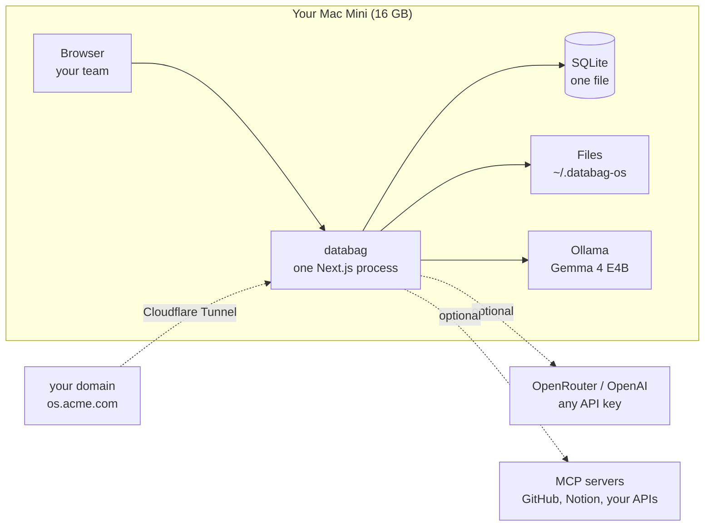
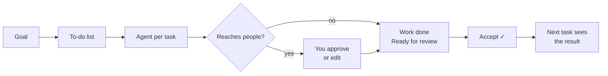

# databag

**An open-source company OS that runs your whole company on one Mac Mini.**

Mail, calendar, meetings, chat, documents, spreadsheets, slides, files, CRM, contacts, projects, e-signatures, accounting, tax and LinkedIn, in one package. On top of them sit **AI agents** you build yourself and **Value Factories**: projects where agents do the work and you approve what goes out.

It runs on a local open model (**Gemma 4**) by default, so nothing leaves the machine. You can switch to OpenRouter, OpenAI or any OpenAI-compatible API whenever you like. MIT licensed.

```bash
curl -fsSL https://raw.githubusercontent.com/vinodkumarbhovi/databag-os/main/install.sh | sh
```

On a new Mac Mini that one line does everything:
- installs Node.js and Ollama
- asks for your **domain**, **company name** and **logo**
- downloads Gemma 4 and starts databag

Then it opens your browser, ready for you to create the first account. Already have Node 24 or newer?

```bash
npx databag-os
```

---

## What you get

| Area | Apps | Replaces |
|---|---|---|
| Communicate | Mail · Calendar (with booking links) · Meet · Chat | Gmail/Outlook, Calendly, Zoom, Slack |
| Create | Docs · Sheets · Slides · Drive | Word, Excel, PowerPoint, Dropbox |
| Customers | CRM · Contacts · Projects · LinkedIn · Sign | HubSpot, Trello, Buffer, DocuSign |
| Money | Accounting (invoices, quotes, recurring, books, bank matching) · Tax | QuickBooks/Xero, VAT spreadsheets |
| Automate | **Agents** · **Value Factories** | custom GPTs, agencies, Zapier-style busywork |

Everything shares one database, so apps work together. For example, a CRM deal becomes a quote, then an invoice, then a bank match. **⌘K** searches everything. An agent panel in every app can do work across all of them, and hold-to-talk dictation (right ⌥) works anywhere.

## How it works



One process, one database file, one local model. Each app is a module in the same process, not a separate server. That is how the whole thing fits in 16 GB, with room left for the model. More diagrams are in [docs/architecture.md](docs/architecture.md).

## Agents: build your own

An agent is a model plus a **harness**. You set each part in the Agents app:

| Part | What it is |
|---|---|
| **System role** | Who the agent is and how it works |
| **Model** | The company AI (local Gemma 4), or its own: OpenRouter, OpenAI, any endpoint |
| **Tools** | Which databag actions it may use: mail, CRM, docs, invoices, LinkedIn… (about 50) |
| **MCP servers** | Outside tools over HTTP: GitHub, Notion, Linear, your own APIs |
| **Skills** | Named playbooks it reads when a job calls for them |
| **Memory** | Facts it chooses to keep between jobs; you can see and delete them |
| **Context** | Background it always knows: products, prices, customers, tone |

Eight starter agents come ready to adjust: Marketing, Campaign, Sales, Outreach, Brand, Builder, Automation and Operations. Anything that reaches other people (email, invitations, posts) waits for a person's OK.

## Value Factories: projects that agents run

Pick a factory and give it a goal. It starts with a to-do list and a suitable agent:
- Campaign
- Sales funnel
- Marketing
- Outreach
- Branding
- New project
- Build an app
- Process automation
- Blank

Run one task, or **Run all**. Each agent sees the goal and what earlier tasks produced. Finished work waits on the task card for you to **Accept**. Factories are projects, so they also appear in Projects. See [docs/agents-and-factories.md](docs/agents-and-factories.md).



## Make it yours

databag is set up for one company at a time, and every install is that company's own:
- **Domain**: your email addresses (`you@acme.com`) and the address people open (`https://os.acme.com`). `databag domain` shows the DNS steps.
- **Logo and colour**: shown in the sidebar, on the sign-in page and as the browser icon.
- **AI**: local Gemma 4 or any API key, set during install or later in **Settings → AI**.
- **Apps**: turn on only the ones you use.

## Install options

| | Where | AI | Guide |
|---|---|---|---|
| **Mac Mini or laptop** | your computer, starts with it | Gemma 4 on the same machine | [docs/install.md](docs/install.md#mac-mini-or-laptop) |
| **Any server, VM or PC** | Docker | bundled Ollama, the host's Ollama, or an API | [docs/install.md](docs/install.md#docker) |
| **Cloud** | Vercel + Turso | OpenRouter | [docs/install.md](docs/install.md#cloud-vercel) |

Gemma 4 E4B takes about 10 GB to download and about 7 GB of memory while working. That fits next to databag on a **16 GB / 256 GB Mac Mini**. On smaller machines, choose an API key during setup instead.

## Commands

```text
databag           set up (first time) and run
databag init      answer the setup questions again (domain, logo, AI, apps)
databag service   install | remove: start with the Mac
databag domain    how to point your domain at this computer
databag doctor    check this machine is ready
databag model     download the local model
databag https     serve over HTTPS with your own certificate
databag restore   put a backup back (a backup is made every day)
```

## Docs

- [Install](docs/install.md): Mac Mini, Docker, cloud, your domain
- [Architecture](docs/architecture.md): how the pieces fit, with diagrams
- [Agents and Value Factories](docs/agents-and-factories.md)
- [Configuration](docs/configuration.md): settings and environment variables
- [Contributing](CONTRIBUTING.md) · [Security](SECURITY.md)

## Status

This is early software. Mail, Calendar, Docs, Sheets, CRM, Accounting, Agents and Value Factories are in daily-use shape. Meet, Slides and LinkedIn publishing are first versions. Not built yet:
- IMAP access for other mail clients
- mail attachments
- mobile apps

## Clean-room policy

databag apps are written from scratch to do the same jobs as the products they replace. No proprietary code is copied or decompiled. File compatibility uses published standards (OOXML, SMTP, iCalendar).

## License

[MIT](LICENSE). Use it, change it, run it for your company or your customers.
