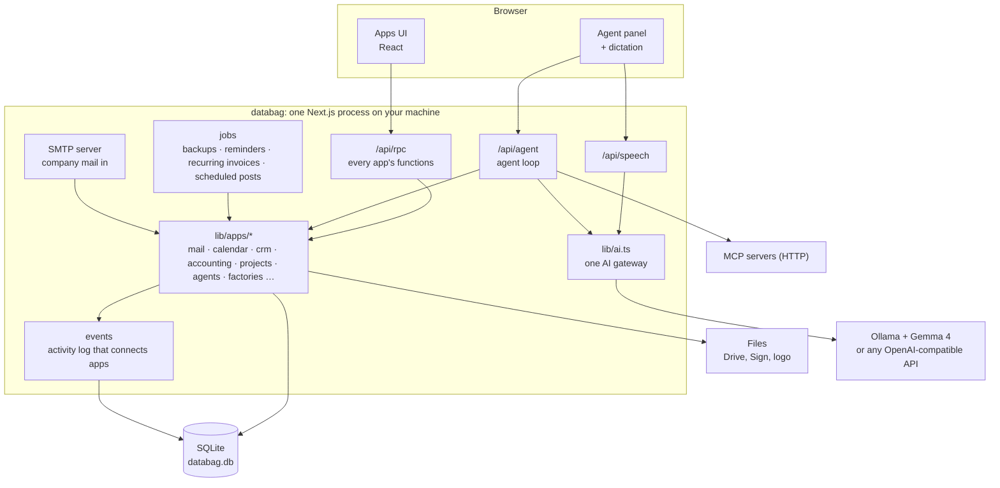
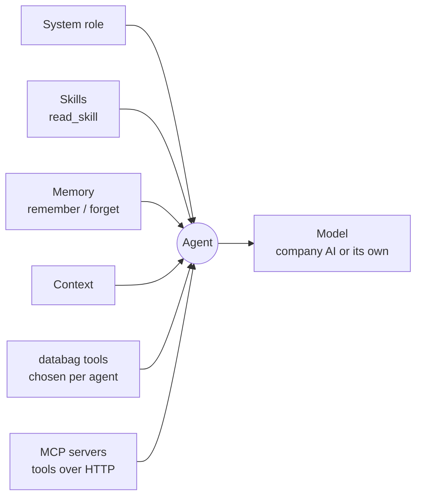
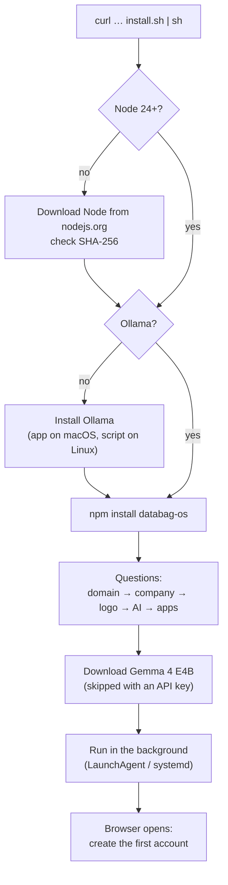

# Architecture

databag is deliberately simple: **one process, one database, one model**.

## The pieces



| Folder | What lives there |
|---|---|
| `bin/databag.mjs` | The installer and command line: setup questions, start, service, backups |
| `shared/` | The app catalog and default settings, used by both the CLI and the server |
| `lib/` | The platform: `db` (SQLite or libSQL), `auth`, `ai` (the AI gateway), `events`, `schema` (every app's tables), `storage` (files) |
| `lib/apps/` | Each app's server logic, exposed as named functions such as `crm.deals` |
| `lib/agent/` | The agent loop, the ~50 built-in tools, agent profiles (the harness) and the MCP client |
| `app/`, `components/` | Pages, API routes and the UI |

All data lives in `~/.databag-os`: the database, settings, files, logo and backups.

## What happens when you ask an agent

```mermaid
sequenceDiagram
  actor You
  participant Panel as Agent panel / factory task
  participant Loop as Agent loop
  participant Model as Gemma 4 (or API)
  participant Tools as databag tools / MCP

  You->>Panel: "Send Ben the Q4 numbers"
  Panel->>Loop: message + who, when, which app
  loop until the model answers (max steps)
    Loop->>Model: role, rules, skills, memory, context, tools
    Model-->>Loop: call a tool
    alt reads, or changes inside databag
      Loop->>Tools: run it
      Tools-->>Loop: result
    else reaches other people (email, invite, post)
      Loop-->>Panel: waits for your OK (text editable)
      You->>Panel: Approve / Don't
      Panel->>Loop: decision
    end
  end
  Loop-->>Panel: what was done
```

- The instructions and tool list stay the same from one request to the next. The local model can therefore keep them cached, and a request takes about half a second instead of three.
- Conversations are stored in the database. An approval still works after a restart, or when another server answers (in the cloud).
- If you decline an action, the reply is fixed rather than written by the model. A small model would otherwise sometimes say it had done the thing anyway.

## An agent's harness



`lib/agent/profile.ts` turns a saved agent into a working one: its system prompt, its tools and its model. See [agents-and-factories.md](agents-and-factories.md).

## Installing on your machine (macOS or Linux)



## Memory budget (a 16 GB machine)

| What | About |
|---|---|
| macOS | 3–4 GB |
| Gemma 4 E4B (loaded while working) | 7 GB |
| databag (Node.js) | 300–500 MB |
| Free for the browser and other apps | 4 GB or more |

This is the same on a 16 GB laptop, Mac Mini or VM. The model takes about 10 GB of disk; company data is usually far smaller. With a hosted model instead, databag itself needs well under 1 GB of memory.

## Three ways to run, one codebase

| | Database | Files | Background jobs | Mail in |
|---|---|---|---|---|
| Your machine: laptop, Mac Mini, VM, server | SQLite file | on disk | timers in the process | built-in SMTP |
| Docker | SQLite in a volume | in the volume | timers in the process | built-in SMTP |
| Vercel | Turso (libSQL) | in the database | Vercel Cron + on use | not available |

`lib/runtime.ts` decides which mode applies, from the environment.
